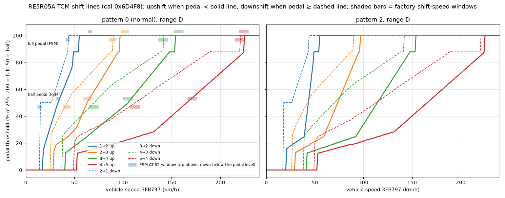

# TCM 02 · Gear ratios, shift schedule, lock-up schedule, gear holds

**ROM:** tcm_RE5R05A_20261119.bin (md5 987776c9c8e483312ad23c55c69e41e6), PowerPC MPC555, r13 = 0x4017F0.
**Status:** code structure CONFIRMED. Units are STRONG: speed in km/h (GPS-fitted id 1101) and pedal as raw throttle_b.
Nothing here is checked against a log in **D**. The one WOT pull on file (2026-11-16, t = 125-142 s) was driven in **manual
mode** (id 1307 = 0x00FF), so it doesn't test the D schedule (§6).

## 1. Gear ratios (cal 0x6843C, ×1024) [CONFIRMED]

| gear | 1 | 2 | 3 | 4 | 5 |
|---|---|---|---|---|---|
| ROM | 3.540 | 2.264 | 1.471 | 1.000 | 0.834 |
| FX Sport turbine/output fit (11-16) | 3.6 | 2.28 | 1.50 | 1.00 | 0.83 |
| FX Sport `TcmIds.RATIOS` (code) | 3.827 | 2.368 | 1.519 | 1.000 | 0.834 |

The drive fit agrees with the ROM, but the constants hard-coded in FX Sport don't (1st to 3rd are off by 3-8 %). **Fix FX Sport's RATIOS to
the ROM values** (pending; not deployed during reads).

## 2. Inputs to the schedule

| RAM | what | source |
|---|---|---|
| 3FB796 | vehicle speed, km/h | 0x42E60: output-shaft count × 0xF3B × 0xA8 >> 24 (= GPS × 1.003) |
| **3FB797** (id 112F) | **processed vehicle speed, km/h**: normally = 3FB796; = speed2 (3FB798) or held when the sensor-fault flags 3FBA38 bits 1/2 are set | 0x42E60 |
| 3FB7A6 | x input to every shift curve: 3FB797; = speed−7 (0x6034A) or 3FB7A8 at ≤ 44 km/h in a special state (3FB21B bit 0); 0xFF when 3FB293 bits 0+1 (forced) | 0x4314C |
| **3FB7FE** | **pedal input to every shift curve: throttle_b 3FB766** (id 1109), because cal 0x60352 bit 1 = 0. Setting it would switch to accel 3FB992 (id 110A). | 0x41A58 (asm-checked) |
| 3FB766 | throttle_b = 3FB884 (from the ECM). Failsafe: 0 at idle switch, 0x40 mid, 0x80 at the WOT switch, or 0x4B0AC | 0x41A58 |

Correction to report 01: 112F / 3FB797 is **processed speed**, not throttle/load. Curves that report 01 described as "vs load"
with input 3FB797 (e.g. 0x60628) are **vs vehicle speed**.

## 3. Shift decision 0x3B580 [CONFIRMED]

```
up   = seg_u8(*3FB8DC, x = 3FB7A6)      # 0x4427C: segments {x0, y0, slope}, y = y0 + slope·(x−x0)/16 on (x0, next x0]
down = seg_u8(*3FB8E0, x = 3FB7A6)
if (pedal < up  or up == 0xFF)  and desired < 5th : desired 3FB7E1 += 1
if (pedal >= down and down != 0xFF) and desired > 1st: desired 3FB7E1 -= 1
target 3FB7DF := 3FB7E1 unless a shift is in progress (3FB17C bit 6 / 3FB187 bits 3,5); 3FB183 bit 5 snaps both to the actual gear 3FB7F3
```

The same comparison runs on two more pointer pairs (3FB8E4/8E8 → "next" target 3FB7E0, 3FB8FC/900 → 3FB7E2, used for
skip/double-shift decisions).

**Curve selection 0x32FC0:** pointer table **0x6D4F8**, 8-byte entries `{up*, down*}`,
`index = pattern×50 + range×10 + target_gear×2` (×4 bytes).

- **range** comes from 3FB7DD (lever): 0x80/0x84/0x8C → 0 (D), 0x85 → 1, 0x81 → 2, 0x82 → 3, 0x83 → 4. Ranges 1-4 progressively remove the top gears, so they look like the manual/limit positions.
- **pattern** comes from 3FB7B6 (0-4 as-is, 5 → 1, 6/7 → 5/6). It's chosen by 0x387C4/0x3891C from the flag byte
  **3FB15B** (decoded 2026-11-19 07:15, cal 0x6055E = 0x15):

  | 3FB15B bit | pattern | set by | meaning |
  |---|---|---|---|
  | none | **0** | | normal D |
  | 6 | 1 | 0x39870: rising edge of switch input 3FB15C bit 0 (cal 6055E b0 = 1, b3 = 0), toggles | driver mode switch [CANDIDATE: which switch] |
  | 5 | 5 | 0x39768: **throttle rate** 3FB790 (= rise of throttle_b over 3 ticks, 0x28C28) > threshold from 0x6058B (64/48/41/24 by pedal quarter below 60 km/h, 64/64/48/48 above; speed bands 30/60/90). Held while pedal ≥ 32 (0x60568) and a hold timer (0x6059B = 60 below 60 km/h, 0 above); lever states 0x80/0x85 only | **"sporty" pattern** after a fast stab of throttle [STRONG] |
  | 4 / 3 | 2 / 6 | 0x39258: 3FB1C4 bits 1/0 (cal 6055E b4 = 1) | [CANDIDATE: manual-mode or hold inputs] |
  | 0 | 4 (if 3FB247 b0) else unchanged | 0x3961C: 3FB164 bit 3 (= **manual mode**, TCM 03 §7) + ATF-temp hysteresis 0x6056D/E (both 0 here) | **manual-mode pattern** [STRONG] |
  | 7 | 3 (or 2/6 with sub-bits) | 0x38ED8: 3FB7A5 vs 190/193 hysteresis, 204-tick timer 0x6055F. 3FB7A5 = curve 0x603F7 of a filtered (255 − 3FB77C); 3FB77C is a TCM analog input (0-5 V → 0-255, 0x202D4) | [CANDIDATE: uphill/altitude or hot pattern] |
- 0x33FEC copies the selected pointers to 3FB8DC/8E0/8E4/8E8/8FC/900 every pass, after the hold layer (§5) has had a chance to override them.

## 4. The D-range shift lines (pattern 0) [CONFIRMED values]



`x` is in km/h and `y` is the throttle_b threshold in raw counts (0-255). An upshift is wanted while throttle < up(x). A downshift is wanted while
throttle ≥ down(x). y = 255 means "always", i.e. a forced shift at that speed regardless of pedal.

| shift | light throttle (32 counts ≈ 13 %) | half (128 ≈ 50 %) | forced at |
|---|---|---|---|
| 1→2 | 18 km/h | 34 km/h | **54 km/h** |
| 2→3 | 28 km/h | 63 km/h | **96 km/h** |
| 3→4 | 40 km/h | 105 km/h | **153 km/h** |
| 4→5 | 55 km/h | 166 km/h | **224 km/h** |
| 2→1 down | below 14 km/h at any pedal; ≥ 50 % pedal up to 26 km/h | | |
| 3→2 down | 25 km/h at 25 % pedal, 47 km/h at 56 % | | |
| 5→4 down | 49 km/h at 19 %, 131 km/h at 60 % | | |

Patterns 0, 1, 2, 3 and 5 share the forced points and differ in the low and mid parts of the lines. Pattern 1/3 1→2 rises
faster (39 km/h at 25 %), and pattern 2's lines are shifted a few km/h later at light throttle. Patterns **4 and 6** are
different: 1→2, 2→3 and 3→4 are always "up" and 4↔5 switches at 45-48 km/h. Correction (TCM 03 §7): 3FB164 bit 3 = manual mode, so patterns **4/7 are the manual-mode patterns**; their always-up lines are
unused because manual mode picks its own target gear [STRONG].

## 5. Gear holds that override the curves (0x33188-0x33AE4) [CONFIRMED structure, CANDIDATE meaning]

These functions replace the curve pointers with sentinels: **0x6D4D9** = "never upshift" (curve returns 0), **0x6D4D5** =
"never downshift" (returns 255), 0x6D4F1/0x6D4DD/0x6D4ED = special lines.

- **Cold ATF:** with ATF temp 3FB794 < **0x606D6 = 55** (raw), 4→5 is inhibited (0x336F4 end), unless cal 0x6055E bit 5 is set. It's clear here (0x15).
  In 5th, a cold ATF swaps in the 0x6D4F1 down-line. → **No overdrive until the fluid warms.**
- **Warm-up 3rd/4th hold:** a timer 3FB7C6 loaded from ATF-temp table **0x60780** ({90 → 13}, then 0) holds the upshift. It's gated by speed ≤ 0x606E2 = 0, so
  it's **disabled** in this calibration.
- **Shift in progress / shift-done flags:** while a shift executes (3FB17C bit 6, 3FB187 bits 3/4/5) both directions are frozen
  (0x33578 path).
- **Cal-disabled features:** 0x606DC = 255 (speed gate never met) and 0x606DE = 0 (temperature gate never met).
- **Shift-completion test 0x3F5C4:** a shift is "done" when the speed-ratio progress 3FB2FC passes a per-shift threshold from
  **0x65784/0x657AC/0x657D4** (×shift index 3FB7E4), or the timer 3FB4A0 passes its limit.

## 6. What the logs say and don't say

On the 2026-11-16 TRANS drive, the car reached 6,518 rpm in 1st at 67.6 km/h (t = 132.8 s) before shifting. By the D lines that's
impossible: forced 1→2 is at 54 km/h, and with throttle_b ≈ 167 at WOT the upshift is wanted from ~42 km/h. **The lever id 1307 reads
0x00FF (manual mode) through that whole pull** (0x08FF = D before and after), so it was a manual-mode pull and the D schedule
wasn't in charge. It's not a contradiction, but it isn't a confirmation either.

**What a D log should show if the decode is right:** WOT from a stop in D upshifts 1→2 around **42-54 km/h (26-34 mph)**, which is
**≈ 4,000-5,000 rpm**. That's surprisingly early for a 4.5 L V8. If a real D pull holds 1st much longer, then throttle_b at
WOT in D is higher than the 167 seen in manual, or there's a kickdown/WOT layer that I haven't decoded yet (candidates: the
3FB293 forced path in 0x4314C, and pattern selection 0x387C4). **One D-range WOT pull with the TRANS profile settles it**
(it already reads 1101/1109/110A/1307). Read-only, no new code.

## 6b. Factory cross-check (added 2026-11-19) [CONFIRMED]

The 2004 FX35/FX45 service manual, AT section (**2004.0 edition**, "Revision: 2004 November", AT-62/AT-63; file
`fx45_online/fsm/at_2004.0.pdf`), lists the speeds at which a good VK45DE AWD car shifts. "Full throttle" and "half throttle
(4/8 pedal)" map onto the decoded lines at **y = 255** and **y = 128**:

| shift | decoded at y = 255 | factory full throttle | decoded at y = 128 | factory half throttle |
|---|---|---|---|---|
| 1→2 | 54 | **64-68** ✗ | 33 | 31-35 ✓ |
| 2→3 | 96 | 98-106 (≈) | 63 | 59-67 ✓ |
| 3→4 | 153 | 152-162 ✓ | 105 | 100-110 ✓ |
| 4→5 | 224 | 219-229 ✓ | ≈160 | 166-176 (≈) |
| 5→4 | 220 | 215-225 ✓ | 112 | 107-117 ✓ |
| 4→3 | 141 | 136-146 ✓ | 70 | 65-75 ✓ |
| 3→2 | 89 | 85-93 ✓ | 42 | 38-46 ✓ |
| 2→1 | 43 | 41-45 ✓ | 14 | 12-16 ✓ |

(km/h; 15 of 16 points inside or at the edge of the factory window.)

What this settles:

1. **The decoded D-range lines are the real schedule**, and x really is km/h.
2. **y is on a 0-255 full-pedal scale** (half pedal = 128, full = 255), not "throttle_b ≈ 167 at WOT". The 167 seen in the
   11-16 manual-mode pull is either a different signal or the lever/manual path. At real full throttle in D the y = 255 points
   (the "forced" column of §4) are the WOT shift speeds.
3. **The one miss is full-throttle 1→2**: the line forces it at 54 km/h, but the factory figure is 64-68 km/h (≈ 6,000-6,150 rpm).
   Something holds 1st at WOT beyond the line. Candidates are the same as in §6: the 3FB293 forced path / x = speed − 7 substitution
   at ≤ 44 km/h in 0x4314C, or a WOT layer in pattern selection 0x387C4. A D-range WOT pull would show which.

Lock-up (AT-63, VK45DE): closed throttle ON 66-74 / OFF 53-61 km/h; half throttle ON **191-199** / OFF 136-144 km/h; slip lock-up
in 4th/5th at closed throttle. Section 7's 5th-gear "up to 196 km/h at 50 %" lands inside the factory half-throttle window.

## 7. Torque-converter lock-up schedule 0x303C8 [CONFIRMED structure; full lock-up on/off naming CONFIRMED 2026-11-20]

**FSM check (AT-63, D 5th, pattern 0):** on-line 0x6DB39 allows lock-up from **71 km/h** at closed throttle and **196** at half pedal
(y = 128); off-line 0x6DB26 from **58** and **142**. FSM: ON 66-74 / OFF 53-61 at closed throttle, ON 191-199 / OFF 136-144 at half
throttle. All four inside, so the 8BC/8C0 pair is full lock-up with the halves named correctly, and the lock-up y axis is the same
0-255 pedal scale as the shift lines. The 8C4/8C8 pair (light pedal < 32 from 44 km/h) is the FSM's closed-throttle slip lock-up [STRONG].

The same comparison (throttle_b < curve(3FB797)) runs on two pointer pairs:

- **3FB8BC / 3FB8C0** from table **0x6E99C/0x6E9A0** → 3FB157 bit 2.
- **3FB8C4 / 3FB8C8** from **0x6EF14** (or **0x6F48C** when 3FB829 ≠ 0) → 3FB157 bit 1.
- 3FB157 bit 0 = neither.
- Index = mode(3FB800+1 → 0-6)×25 + range×5 + gear.
- State 3FB826 (0x30304) picks which half of each pair is in force: on-line vs off-line hysteresis, plus a pedal gate 0x67304.

| gear (pattern 0, D) | 8BC/8C0 pair (full lock-up?) | 8C4/8C8 pair (slip / partial lock?) |
|---|---|---|
| 1st-3rd | never | never |
| 4th | only the "off" line: held above 88 km/h at ≤ 13 % pedal | ≥ 44 km/h, pedal < 32 counts |
| 5th | from 70-89 km/h at light pedal, up to 196 km/h at 50 % | ≥ 44 km/h, pedal < 32 counts |

Consistent with the logs so far: no city-speed lock-up in 5th (0 % locked samples at 60-79 km/h). The samples are too sparse to call
it checked. A special-case pair 0x6D4C5/0x6D4C9 and 0x6D4CD/0x6D4D1 is used when 3FB1C3 bit 3 is set and cal 0x6077F masks the mode.

## 8. Tuning notes (what you'd change, not a recommendation to flash)

- **Firmer WOT shift points:** raise the "forced" x of each up-line (the `(x, 255, 0)` point), e.g. 1→2 54 → ~70 km/h. Also move
  the 128-224 part of the line right so throttle ≈ 167 doesn't trigger the upshift early. The down-lines must stay left of
  the up-lines, or it will hunt.
- **Use the real pedal:** cal **0x60352 bit 1 = 1** makes the schedule use accel (id 110A, 255 at WOT) instead of throttle_b.
  That's a one-bit change, but it rescales every line (WOT goes from ~167 to 255), so the lines would need re-drawing.
- **Overdrive when cold:** 0x606D6 (55 raw ATF temp) sets when 5th is allowed.
- Any cal edit needs the CRC-16/XMODEM at **0x6FFFC** over 0x60090-0x6FFFB (report 01 §3). The flashing method is undecided.

## Files

- `scripts/tcmshift.py`: dump the pointer table plus curves.
- `scripts/tcmshift2.py`: forced-shift points for every pattern/range.
- `scripts/tcmlu.py`: lock-up tables.
- `scripts/tcmshiftplot.py`: draws `img/shift_lines.png`.
- `scripts/ppcdis.py`: minimal D-form PPC disassembler used for the asm checks.

Decompiles are in `data/dec_all.c` (0x3B580, 0x32FC0, 0x33188-0x33AE4, 0x33FEC, 0x303C8, 0x30304, 0x4314C, 0x41A58, 0x42E60, 0x3F5C4).
